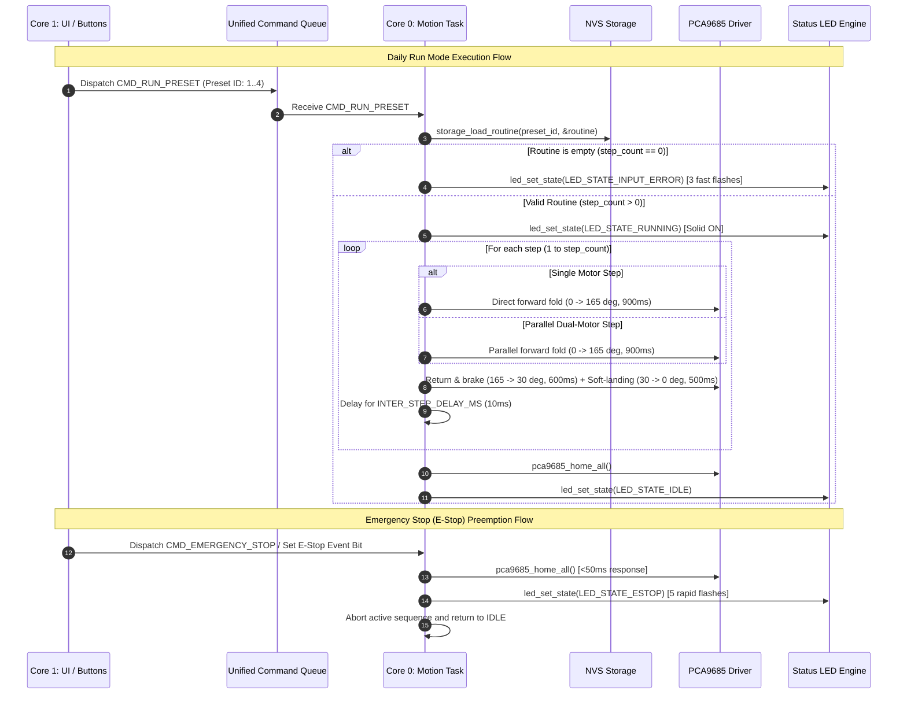

# Requirements — Phase 5: Motion Engine & Daily Run Mode Execution

## Scope

The Motion Engine & Daily Run Mode Execution subsystem provides the real-time motion control, step sequencing, and emergency safety mechanisms for the **Fabrica Cloth Folding Robot** on the **ESP32-S3-DevKitC-1**.

### In-Scope Deliverables
1. **Core 0 Real-Time Motion Task** (`main/motion.h`, `main/motion.c`):
   - Dedicated FreeRTOS task pinned to Core 0 with priority 10.
   - Deterministic execution of sequential steps (Step 1 to $N$, up to 16 steps per routine).
   - Single motor direct fold sweep with mid-air brake and linear soft-landing ($0^\circ \to 165^\circ \to 30^\circ \to 0^\circ$).
   - Synchronized parallel dual-motor direct fold sweep with mid-air brake and linear soft-landing ($0^\circ \to 165^\circ \to 30^\circ \to 0^\circ$).
   - `FOLD_FORWARD_SWEEP_MS` (900ms) direct forward fold to $165^\circ$, `LANDING_APPROACH_MS` (600ms) return & mid-air brake settle at $30^\circ$ (`LANDING_START_ANGLE_DEG`), and `LANDING_RAMP_MS` (500ms, 25 frames $\times$ `LANDING_STEP_MS` 20ms, $-1.2^\circ$/frame, $60^\circ\text{/s}$) linear soft-landing to $0^\circ$ (2000ms total per step).
   - `INTER_STEP_DELAY_MS` (10ms) settling pause between consecutive steps.
2. **Daily Run Mode Trigger Dispatcher**:
   - Short tap (<500ms) on B1–B4 triggers execution of Preset 1–4.
   - Routine loaded directly from NVS storage (`storage_load_routine()`).
   - Visual LED feedback binding (`LED_STATE_RUNNING` while active, `LED_STATE_IDLE` on completion).
3. **Safety & Protective Mechanisms**:
   - **Empty Preset Protection**: Tapping a button associated with an empty routine (0 steps) immediately triggers `LED_STATE_INPUT_ERROR` (3 fast flashes) and aborts without commanding servos.
   - **Emergency Stop (E-Stop)**: Tapping any button or dispatching `CMD_EMERGENCY_STOP` while motion is running immediately aborts active execution in $<50\text{ms}$, commands all 16 PCA9685 channels flat to $0^\circ$, sets `LED_STATE_ESTOP` (5 rapid flashes), and transitions motion status to `MOTION_STATUS_ABORTED`.
   - **Re-Entrancy / Busy Safeguard**: Rejects secondary run requests while motion is already active.
4. **Host Test Suite & Integration**:
   - Host test harness `firmware/test/test_motion.c` integrated into `Makefile`.
   - Complete integration in `firmware/main/main.c` and `firmware/main/CMakeLists.txt`.

---

## Decisions

1. **Direct Fold Sweep with Mid-Air Brake & 50 Hz Linear Soft-Landing**:
   - Forward sweep commands $165^\circ$ (`FOLD_TARGET_ANGLE_DEG`) directly for 900ms (`FOLD_FORWARD_SWEEP_MS`), returns and brakes at $30^\circ$ (`LANDING_START_ANGLE_DEG`) for 600ms (`LANDING_APPROACH_MS`), and executes a linear $-1.2^\circ$ per 20ms (`LANDING_STEP_MS`, `LANDING_RAMP_MS = 500ms`, 25 frames, 50 Hz native PWM, $60^\circ\text{/s}$) soft-landing to $0^\circ$ (`HOME_ANGLE_DEG`) via `pca9685_set_servo_angle()` and `pca9685_set_multi_servo_angles()`. Each step completes fully to $0^\circ$ sequentially (max 2 motors/step) before the next step begins.
2. **Core 0 Pinned Task Execution**:
   - The motion task executes on CPU Core 0, isolating real-time I2C actuation and motion timing from UI button debouncing, LED timer patterns, and NVS flash operations running on Core 1.
3. **Sub-50ms E-Stop Abort Polling**:
   - During every sweep, return, soft-landing frame, and inter-step delay, delays are executed in 10ms slices (`MOTION_ABORT_CHECK_MS`) checking `MOTION_EVENT_ESTOP_BIT` to ensure E-Stop signals abort motion in $<50\text{ms}$.
4. **All-Channel Homing on Abort / Complete**:
   - On both clean completion and emergency abort, the motion engine commands all 16 PCA9685 channels to $0^\circ$ (`HOME_ANGLE_DEG`) to ensure all folding flaps rest flat.

---

## Constraints

| Parameter | Specification | Source / Rationale |
|---|---|---|
| **Target Microcontroller** | ESP32-S3-DevKitC-1 (ESP32-S3-WROOM-1) | Hardware Constitution |
| **Motion Task Core** | CPU Core 0 | Dual-core RTOS partition (`tech-stack.md`) |
| **Motion Task Priority** | 10 (Highest application priority) | Deterministic real-time timing |
| **Motion Task Stack** | 4096 bytes | Internal DRAM budgeting |
| **Servo Angles** | Home: $0.0^\circ$, Brake / Soft-Landing Start: $30.0^\circ$, Fold Target: $165.0^\circ$, Max Range: $180.0^\circ$ | `config.h` mechanical specifications |
| **Forward Fold Sweep** | $900\text{ ms}$ (`FOLD_FORWARD_SWEEP_MS`) | Direct forward fold $0^\circ \to 165^\circ$ |
| **Return & Mid-Air Brake** | $600\text{ ms}$ (`LANDING_APPROACH_MS`) | Return & bounce settle at $30^\circ$ ($165^\circ \to 30^\circ$) |
| **Soft-Landing Ramp** | $500\text{ ms}$ (`LANDING_RAMP_MS`, $25 \times 20\text{ ms}$ `LANDING_STEP_MS`) | Linear $-1.2^\circ$/frame (50 Hz PWM, $60^\circ\text{/s}$) $30^\circ \to 0^\circ$ |
| **Inter-Step Delay** | $10\text{ ms}$ (`INTER_STEP_DELAY_MS`) | Flap settling & mechanical inertia damping |
| **E-Stop Latency** | $< 50\text{ ms}$ | User safety & mechanical jam prevention |
| **Max Steps Per Routine**| 16 steps (`MAX_STEPS_PER_ROUTINE`) | Storage and memory architecture |
| **Max Motors Per Step** | 2 motors (`MAX_MOTORS_PER_STEP`) | Current draw & mechanical geometry |

---

## Non-goals

1. **State Machine & Custom Sequence Configuration**:
   - System state coordination, BLE pairing window lifecycle, and wireless sequence programming are handled in **Phases 6–9** (`state_machine.c`, `ble_transport.c`, `remote_cmd.c`).
2. **Wireless BLE Mobile Execution**:
   - Wireless transport ingestion and mobile app synchronization are implemented in **Phase 8**.
3. **Servo Speed / Velocity Acceleration Profiles**:
   - Smooth multi-point S-curve or velocity ramping profiles are non-goals for Phase 5; direct target positioning is standard for MG996R servos.
4. **Current / Stall Sensing Feedback**:
   - Hardware does not include shunt current sensing; jam protection is achieved via operator E-Stop button press.

---

## Context & System Architecture

