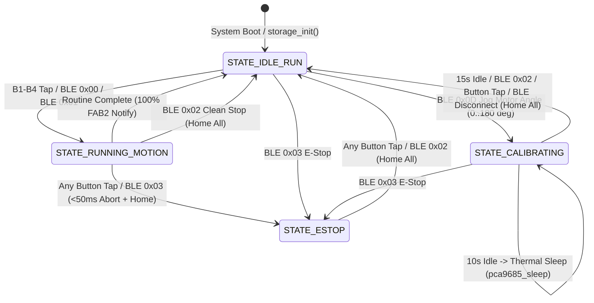

# Requirements — Phase 6: State Machine Coordinator & Minimal Physical Button Interface

> [!NOTE]
> **Architecture Update (Superseded On-Device Visual Staging)**: The original Phase 6 concept proposed on-device multi-button visual staging (`STATE_PROGRAMMING`, `15°` nudge, `30°` stage hold). In production firmware, custom sequence programming and servo calibration were offloaded to BLE GATT (`FAB1` / `FAB3` and `CMD_JOG_MOTOR_ANGLE`) so the physical 4-button pad stays effortless and free of hidden modes. This specification reflects the active production implementation in `main/state_machine.h` and `main/state_machine.c`.

## Scope

The State Machine Coordinator (`main/state_machine.h`, `main/state_machine.c`) orchestrates operating modes, physical button gesture routing, BLE pairing window lifecycle, live servo calibration safety watchdogs, latched Emergency Stop recovery, and NVS preset/factory-reset dispatch for the **Fabrica Cloth Folding Robot** on the **ESP32-S3-DevKitC-1**.

### In-Scope Deliverables
1. **Core State Machine Engine** (`main/state_machine.h`, `main/state_machine.c`):
   - Central coordinator managing `STATE_IDLE_RUN = 0`, `STATE_RUNNING_MOTION = 1`, `STATE_ESTOP = 2` (wire byte `3` reserved), and `STATE_CALIBRATING = 4`.
   - Context tracking for active preset ID (`0` when idle/raw preview, `1..4` during button routine), BLE pairing window (`120s` timed window when bonded peers exist; indefinite when 0 bonds exist via cached `s_ble_pairing_indefinite`), and calibration thermal/inactivity watchdogs.
2. **Minimal Physical Button Interface**:
   - **Short Tap (`<500ms`) in Idle**: Triggers Preset 1–4 (`CMD_RUN_PRESET`) from NVS Flash.
   - **Any Button Tap in Motion**: Triggers immediate `<50ms` Emergency Stop (`CMD_EMERGENCY_STOP`), homing all 16 servos and latching `STATE_ESTOP`.
   - **Any Button Tap in E-Stop / Calibrating**: Dispatches `CMD_STOP_SEQUENCE`, clearing `STATE_ESTOP` or homing jogged servos back to `STATE_IDLE_RUN`.
   - **Single-Button Hold (`≥3000ms`)**: Dispatches `CMD_ENTER_BLE_PAIRING` (`LED_STATE_BLE_PAIRING`), disconnecting any active central and opening the pairing window.
   - **`B1 + B4` Simultaneous Hold (`≥5000ms`)**: Dispatches `CMD_CLEAR_BLE_BONDS`, wiping all NVS BLE bonds and auto-reopening indefinite pairing mode.
   - **`B1 + B3 + B4` Simultaneous Hold (`≥10000ms`)**: Dispatches `CMD_FACTORY_RESET_ALL`, restoring factory default presets, clearing all BLE bonds, homing all 16 servos, and re-entering indefinite pairing mode.
3. **Wireless Sequence & Calibration Coordination**:
   - `CMD_SET_BUTTON_SEQUENCE`: Validates and saves custom sequences received over BLE (`FAB1` / `FAB3`) into NVS Presets 1–4 with `LED_STATE_SAVE_SUCCESS` (2.0s solid ON) and `FAB3` notification.
   - `CMD_RESTORE_FACTORY_PRESETS`: Restores all 4 NVS preset slots to factory defaults and notifies `FAB3`.
   - `CMD_RUN_RAW_SEQUENCE`: Previews an unsaved custom sequence directly in RAM (`active_button_id == 0`).
   - `CMD_JOG_MOTOR_ANGLE`: Enters `STATE_CALIBRATING` for live servo angle control (`0°..180°`) with 10s PCA9685 thermal sleep cutoff and 15s inactivity auto-home exit.
4. **Integration & Host Test Suite**:
   - Dynamic state-aware button gesture translation in `main/buttons.c`.
   - Host test harness `firmware/test/test_state_machine.c` covering all state transitions, gestures, watchdogs, BLE pairing, calibration, and E-Stop preemption.
   - Integration with `main/main.c`, `main/CMakeLists.txt`, and `firmware/Makefile`.

---

## Decisions

1. **Dedicated State Machine Coordinator**:
   - State management is encapsulated in `state_machine.c`, decoupling UI gesture parsing (`buttons.c`), BLE transport (`ble_transport.c` / `remote_cmd.c`), and Core 0 motion execution (`motion.c`).
2. **Thread-Safe Core 1 Watchdog Dispatch**:
   - Calibration thermal cutoff (`CMD_CALIBRATION_THERMAL_SLEEP`) and inactivity exit (`CMD_STOP_SEQUENCE`) are posted onto `xCommandQueue` from `state_machine_tick()` on `ESP_PLATFORM` so all PCA9685 I2C transactions remain serialized on Core 0.
3. **Zero-Poll Indefinite Pairing Cache**:
   - `s_ble_pairing_indefinite` is evaluated once upon entering pairing mode so the 100 Hz `state_machine_tick()` loop never polls the NimBLE NVS bond store.
4. **Telemetry Wake Notification**:
   - State transitions call `telemetry_notify_state_change()` so `app_telem_task` switches immediately between 1 Hz idle and 10 Hz active motion/calibration streaming.

---

## Constraints

| Parameter | Specification | Source / Rationale |
|---|---|---|
| **Target Microcontroller** | ESP32-S3-DevKitC-1 (ESP32-S3-WROOM-1) | Hardware Constitution |
| **Max Presets** | 4 presets (Presets 1–4) | 4 physical buttons B1–B4 |
| **Max Steps Per Routine** | 16 steps (`MAX_STEPS_PER_ROUTINE`) | Storage schema & RAM budget |
| **Max Motors Per Step** | 2 motors (`MAX_MOTORS_PER_STEP`) | Servo current draw & kinematics |
| **Total Servo Channels** | 16 channels (`TOTAL_SERVO_CHANNELS`) | PCA9685 16-channel driver |
| **Long Press Duration** | $\ge 3000\text{ ms}$ (`BUTTON_LONG_PRESS_MS`) | Enter BLE pairing window |
| **Bond Reset Hold** | $\ge 5000\text{ ms}$ (`BUTTON_BOND_RESET_MS`) | `B1+B4` wipe BLE bonds |
| **Factory Reset Hold** | $\ge 10000\text{ ms}$ (`BUTTON_FACTORY_RESET_MS`) | `B1+B3+B4` wipe presets + bonds |
| **BLE Pairing Timeout** | $120000\text{ ms}$ (`BLE_PAIRING_TIMEOUT_MS`) | Multi-device pairing timeout (indefinite on 0 bonds) |
| **Calibration Cutoffs** | $10000\text{ ms}$ thermal sleep / $15000\text{ ms}$ auto-home | Protect stationary servos from overheating |
| **Home Angle** | $0.0^\circ$ (`HOME_ANGLE_DEG`) | Flat panel resting position |

---

## Context & State Transition Architecture

