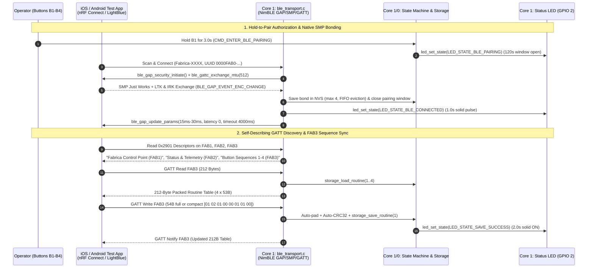

# Requirements — Phase 8: Wireless Transport: NimBLE GATT Server & iOS/Android Interop

## Scope

Phase 8 delivers the Bluetooth Low Energy (BLE) peripheral and GATT server subsystem (`ble_transport.h`, `ble_transport.c`) on **Core 1** of the **ESP32 Dev Board v1** using the ESP-IDF native **Apache NimBLE** stack.

All BLE functionality is implemented strictly in firmware to support both **iOS (`CoreBluetooth`)** and **Android (`BluetoothGatt`)** out of the box and to allow full functional verification using off-the-shelf App Store BLE scanner/test applications (**nRF Connect for Mobile** and **LightBlue**) prior to building any custom mobile app.

### In-Scope Deliverables

1. **Apache NimBLE Stack & Core 1 Task Allocation (`sdkconfig.defaults`, `ble_transport.c`)**:
   - Pin the NimBLE host task (`app_ble_task`, Priority 4, 4096-byte stack) to **Core 1** so wireless interrupts and GATT transactions introduce zero timing jitter on **Core 0** real-time servo motion and PCA9685 I2C communication.
   - Enforce a single active central connection policy (`max_connections = 1`), stopping advertising while connected and automatically restarting advertising upon disconnection.

2. **31-Byte Split Advertising for iOS & Android Discovery**:
   - **Primary Advertisement Packet (21 Bytes $\le 31\text{B}$ limit)**: Flags (`0x06`: LE General Discoverable + BR/EDR Not Supported, 3B) + Complete List of 128-bit Service UUIDs (`0000FAB0-0000-1000-8000-00805F9B34FB`, 18B). Required for iOS `CoreBluetooth` service-filtered and background scanning and Android `BluetoothLeScanner` filters.
   - **Scan Response Packet (17 Bytes $\le 31\text{B}$ limit)**: Complete Local Name (`"Fabrica-XXXX"` derived from the last 2 bytes of the ESP32 BT MAC address, 14B) + Tx Power Level (3B) for immediate human-readable identification in nRF Connect and LightBlue on iOS and Android.

3. **Firmware-Driven Connection Parameters & ATT MTU Exchange**:
   - **Peripheral-Initiated Connection Parameter Update (`ble_gap_update_params`)**: Firmware requests Apple Accessory Design Guidelines and Android compliant parameters 1.5 seconds after connection establishment:
     - Connection Interval Min: `15.0ms` (`12` units)
     - Connection Interval Max: `30.0ms` (`24` units)
     - Slave Latency: `0`
     - Supervision Timeout: `4000ms` (`400` units)
   - **Peripheral- & Central-Initiated ATT MTU Negotiation (`512` Bytes)**: Firmware sets preferred MTU to `512` (`ble_att_set_preferred_mtu(512)`), handles central-initiated MTU exchange from iOS (`185–517B`), and proactively initiates `ble_gattc_exchange_mtu()` from the peripheral side so Android centrals upgrade from their default 23-byte MTU automatically in off-the-shelf test apps.
   - **Offset-Sliced GATT Long Read Fallback (`ATT_READ_BLOB_REQ`)**: `FAB2` (31B) and `FAB3` (212B) read handlers support `ctxt->offset` slicing so legacy 23-byte MTU centrals can still read complete payloads across multiple chunks.

4. **Strict Hold-to-Pair BLE Security, Native SMP Bonding & RPA Resolution**:
   - **3-Second Hold-to-Pair Window (Priority Preemption)**: Holding any physical button (`B1–B4`) for $\ge 3000\text{ms}$ in `STATE_IDLE_RUN` dispatches `CMD_ENTER_BLE_PAIRING`, opening a **120-second pairing window** (`BLE_PAIRING_TIMEOUT_MS = 120000`), flashing `LED_STATE_BLE_PAIRING`, and calling `ble_transport_enter_pairing_mode()` to disconnect any active central and force GAP advertising immediately.
   - **Peripheral-Initiated SMP "Just Works" + IRK Bonding**: Firmware configures NimBLE SMP (`sm_sc = 1`, `sm_bonding = 1`, `sm_mitm = 0`, `sm_io_cap = BLE_HS_IO_NO_INPUT_OUTPUT`, `BLE_SM_PAIR_KEY_DIST_ENC | BLE_SM_PAIR_KEY_DIST_ID`) and calls `ble_gap_security_initiate(conn_handle)` upon connection so both iOS and Android trigger native OS pairing and exchange Identity Resolving Keys (IRKs) inside nRF Connect / LightBlue.
   - **Unbonded Rejection Outside Pairing Window**: When `state_machine_is_ble_pairing() == false`, unbonded centrals are immediately terminated (`ble_gap_terminate`), while up to 4 bonded centrals in NVS resolve rotating 15-minute Resolvable Private Addresses (RPAs) via stored IRKs and reconnect seamlessly (`LED_STATE_BLE_CONNECTED` 1.0s solid pulse).
   - **4-Bond NVS Store with FIFO Eviction & `B1 + B4` 5-Second Bond Reset**: Store up to 4 bonded peers in NVS (evicting the oldest bond when a 5th device pairs). Holding `B1 + B4` simultaneously for $\ge 5000\text{ms}$ (`BUTTON_BOND_RESET_MS = 5000`) suppresses the 3s single-button pairing gesture, dispatches `CMD_CLEAR_BLE_BONDS`, clears all bonds in NVS, disconnects any active central, and flashes `LED_STATE_INPUT_ERROR` (3 fast flashes).

5. **Standard & Custom GATT Services with Self-Describing `0x2901` Descriptors**:
   - **Generic Attribute Service (`0x1801`)**: Exposes Service Changed (`0x2A05`) to prevent stale iOS/Android GATT attribute caching across firmware updates.
   - **Device Information Service (`0x180A`)**: Exposes Model Number (`0x2A24`: `"Fabrica-DevKit-v1"`), Firmware Revision (`0x2A26`: `"v1.13.0"`), and Manufacturer Name (`0x2A29`: `"Fabrica Robotics"`).
   - **Fabrica Primary Service (`0000FAB0-0000-1000-8000-00805F9B34FB`)**:
     - `FAB1` (`0000FAB1-...`, `Write | Write Without Response`, `0x2901`: `"Fabrica Control Point (FAB1)"`): Ingests binary command opcodes (`0x00–0x03`, `0x0A–0x11`) into `xCommandQueue` with `SOURCE_BLE` and fast-path `<50ms` E-Stop signaling.
     - `FAB2` (`0000FAB2-...`, `Read | Notify`, `0x2902` CCCD, `0x2901`: `"Fabrica Status & Telemetry (FAB2)"`): Exposes the packed 31-byte `telemetry_packet_t` (Little-Endian).
     - `FAB3` (`0000FAB3-...`, `Read | Write | Notify`, `0x2902` CCCD, `0x2901`: `"Fabrica Button Sequences 1-4 (FAB3)"`): Reads/notifies the 212-byte ($4 \times 53\text{B}$) button sequence table; accepts full 212B table writes, 54B single-button writes (`[1B preset_id][53B fold_routine_t]`), and compact variable-length single-button writes (`[1B preset_id][1B step_count][3B * N steps]`, 5–50B) with active-motion write lock (`CMD_STATUS_ERR_BUSY`) and auto-CRC32 calculation.

6. **Visual Feedback & Identification Extensions (`led.c`)**:
   - Implement automatic `LED_STATE_BLE_CONNECTED` (1.0s solid ON, transient) and `LED_STATE_IDENTIFY` (3 fast double-blinks over 3.0s, transient) restoring the underlying persistent base state.

---

## Decisions

1. **Strict Hold-to-Pair Default Policy**:
   - The 120-second pairing window (`CMD_ENTER_BLE_PAIRING` via 3s physical button hold) is strictly enforced by default, including on first boot. Unbonded centrals connecting outside this window are terminated immediately, preventing unauthorized BLE connections while allowing bonded devices to reconnect seamlessly via IRK resolution.
2. **Peripheral-Initiated Security, MTU & Connection Parameters**:
   - Because off-the-shelf test apps (nRF Connect / LightBlue) on iOS and Android do not execute custom connection-setup hooks, the ESP32 peripheral proactively initiates `ble_gap_security_initiate()`, `ble_gattc_exchange_mtu()`, and `ble_gap_update_params()` upon connection.
3. **Full Struct + Compact Payload Dual Support on `FAB3` & `FAB1`**:
   - Supporting both the fixed 53B/54B/212B packed binary structures and compact variable-length step payloads (`[preset_id][step_count][3B * step_count]`) with automatic zero-padding and IEEE 802.3 CRC32 computation makes manual sequence entry in nRF Connect / LightBlue fast and error-free while preserving strict binary struct parity.
4. **Backward-Compatible `cmd_type_t` Enumeration**:
   - Existing `cmd_type_t` enum values (`0..8`) in `main/command.h` remain untouched so all 566 existing unit test checks pass without modification; new BLE commands are appended starting at index `9`.

---

## Constraints

| Constraint | Specification | Source / Rationale |
|---|---|---|
| **BLE Stack & Core Affinity** | Apache NimBLE pinned to Core 1 (`Priority 4`, `4096B` stack) | Zero timing jitter on Core 0 servo motion |
| **Primary Adv Packet Size** | $\le 31\text{ Bytes}$ (`21B` exact: `3B` Flags + `18B` 128-bit UUID) | Mandatory for iOS `CoreBluetooth` discovery |
| **Scan Response Packet Size** | $\le 31\text{ Bytes}$ (`17B` exact: `14B` Name + `3B` Tx Power) | Immediate `"Fabrica-XXXX"` name display |
| **Connection Parameters** | `15.0ms–30.0ms` interval, `0` latency, `4000ms` timeout | Apple Accessory Design Guidelines & Android |
| **Preferred ATT MTU** | `512` Bytes ($\ge 247\text{B}$ for single-read `212B` `FAB3` table) | Single-packet sequence table & telemetry |
| **Packed Struct Sizes** | `fold_step_t = 3B`, `fold_routine_t = 53B`, `telemetry_packet_t = 31B` | Zero compiler padding across architectures |
| **Pairing Window & Bond Cap** | `120000ms` window (3s hold); max `4` bonds (FIFO eviction) | Proof-of-physical-presence security |
| **Hardware Bond Reset** | `B1 + B4` simultaneous hold for `5000ms` | Recovery without reflashing firmware |
| **Internal SRAM Headroom** | Net free heap $\ge 190\text{ KB}$ after NimBLE initialization | Long-term RTOS stability |

---

## Non-goals

1. **Custom Mobile Application Code**:
   - No iOS (Swift), Android (Kotlin/Java), or Flutter mobile application code is developed in this repository; all verification uses host unit tests and existing App Store BLE test tools (nRF Connect / LightBlue).
2. **Full Calibration Watchdog & Stateful Remote Execution Rules (Phase 9)**:
   - While `FAB1` ingests all command opcodes in Phase 8, the full `STATE_CALIBRATING` 10s thermal cutoff / 15s inactivity auto-home watchdog and stateful `remote_cmd.c` execution rules are completed in **Phase 9**.
3. **10 Hz / 1 Hz Background Telemetry Task (Phase 10)**:
   - While `FAB2` GATT Read/Notify transport is registered in Phase 8, the dedicated `app_telem_task` adaptive 10 Hz / 1 Hz streaming engine (`telemetry.c`) is implemented in **Phase 10**.

---

## Context & System Interaction

