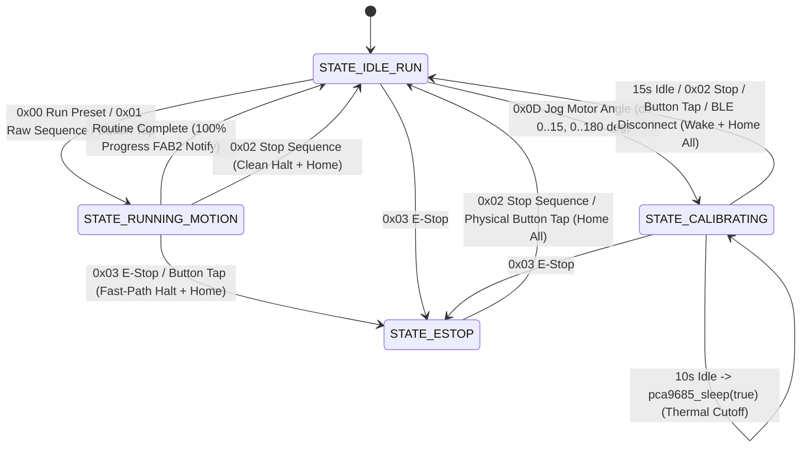

# Requirements — Phase 9: BLE Command Dispatch, Remote Execution & Servo Calibration

## Scope

Phase 9 implements the BLE wire command dispatch engine, stateful remote sequence execution & preemption logic, latched Emergency Stop safety workflow, immediate `FAB2` command status notifications, and thermal-protected live servo calibration mode (`remote_cmd.h`, `remote_cmd.c`, `command.h`, `state_machine.h`, `state_machine.c`, `buttons.c`, `ble_transport.c`) on the **ESP32 Dev Board v1**.

All wireless control and calibration features remain strictly firmware-native and directly operable from off-the-shelf App Store BLE scanner apps (**nRF Connect for Mobile** and **LightBlue**) on both **iOS** and **Android** without any custom mobile application code.

### In-Scope Deliverables

1. **Dedicated BLE Command Parser & Validator (`remote_cmd.h`, `remote_cmd.c`)**:
   - Extract `FAB1` (`0000FAB1-...`) and `FAB3` (`0000FAB3-...`) payload parsing, routine validation, compact sequence expansion, Core 1 fast-path preemption, and `cmd_status_t` tracking into `main/remote_cmd.h` and `main/remote_cmd.c`, invoked by thin GATT wrappers in `main/ble_transport.c`.
   - Support both fixed-size packed wire frames (`53B` `fold_routine_t`, `54B` `button_sync_param_t`, `212B` `FAB3` table) and compact variable-length step payloads (`[step_count (1-16)][3B * step_count]` for `0x01`, or `[preset_id (1-4)][step_count (1-16)][3B * step_count]` for `0x0A` / `FAB3`) with automatic trailing zero-padding and IEEE 802.3 CRC32 calculation.
   - Enforce strict pre-execution validation across all sequence inputs:
     - `step_count == 0` $\rightarrow$ `CMD_STATUS_ERR_INVALID_STEP`
     - `step_count > 16` $\rightarrow$ `CMD_STATUS_ERR_ROUTINE_FULL`
     - `motor_count < 1 || motor_count > 2` or `motor_ids[m] > 15` $\rightarrow$ `CMD_STATUS_ERR_MOTOR_BOUNDS`
     - Non-zero corrupted CRC32 in full 53B frames $\rightarrow$ `CMD_STATUS_ERR_CRC_MISMATCH`
     - Malformed payload length, unknown opcode, or `preset_id` outside `1..4` $\rightarrow$ `CMD_STATUS_ERR_INVALID_ARG`

2. **Remote Sequence Execution, Busy Guards & Completion Telemetry**:
   - **Start Preset Routine (`CMD_RUN_PRESET`, Opcode `0x00`)**: Trigger stored Button `1–4` routines (`[0x00][preset_id (1-4)]`) over BLE, reporting `active_button_id = preset_id` in telemetry during motion.
   - **Stateless Raw Sequence Execution (`CMD_RUN_RAW_SEQUENCE`, Opcode `0x01`)**: Execute unsaved 54-byte full or `5..50`-byte compact routines directly in RAM without modifying NVS presets, reporting `active_button_id = 0` in telemetry.
   - **Ingress Re-Entrancy & Busy Guard**: Reject `0x00`, `0x01`, `0x0A`, `0x0C`, `0x0D`, and `FAB3` writes immediately at Core 1 BLE ingress with `CMD_STATUS_ERR_BUSY` whenever `motion_is_busy()` is true or `system_state` is `STATE_RUNNING_MOTION` or `STATE_ESTOP` (while starting `0x00`/`0x01` or `0x0C` from `STATE_CALIBRATING` automatically wakes/homes servos and exits calibration cleanly), without queueing behind or disrupting active motion.
   - **Empty Preset Validation**: Reject execution of any preset with `step_count == 0` with `CMD_STATUS_ERR_INVALID_STEP` and flash `LED_STATE_INPUT_ERROR`.
   - **Execution Completion Notification**: Upon clean completion of the final step of a preset or raw routine, emit a dedicated 31-byte `FAB2` telemetry notification with `step_progress_pct = 100` and `last_cmd_status = CMD_STATUS_OK` before returning to `STATE_IDLE_RUN`.

3. **Fast-Path Preemption & Latched Emergency Stop (`STATE_ESTOP`)**:
   - **Core 1 Fast-Path Signal (`<50ms` Latency)**: Receiving `0x02` (`BLE_OP_STOP_SEQUENCE`) or `0x03` (`BLE_OP_EMERGENCY_STOP`) on Core 1 immediately invokes `motion_emergency_stop()` (setting `MOTION_EVENT_ESTOP_BIT` on `xSystemEventGroup`) prior to command queue dispatch so Core 0 trajectory waits abort within `<50ms`.
   - **Latched `STATE_ESTOP` (`0x03` or Physical Button Tap During Motion)**: Aborts motion, wakes PCA9685 if asleep, homes all 16 servo channels to $0^\circ$, flashes `LED_STATE_ESTOP` (5 rapid flashes), sets `error_code` `BIT2` (`ESTOP_ACTIVE`), and latches `system_state = STATE_ESTOP` (`2`).
   - **Explicit Clear (`0x02` or Physical Button Tap in `STATE_ESTOP`)**: Sending `CMD_STOP_SEQUENCE` (`0x02`) over BLE or tapping any physical button (`B1–B4`) while in `STATE_ESTOP` homes all 16 flaps to $0^\circ$, clears `STATE_ESTOP` back to `STATE_IDLE_RUN` (`0`), clears `error_code` `BIT2`, and restores `LED_STATE_IDLE` (without closing an active BLE pairing window if open).

4. **Wireless Preset Slot Management, Factory Reset & Immediate Status Push**:
   - **Direct Button Save (`CMD_SET_BUTTON_SEQUENCE`, Opcode `0x0A` & `FAB3` Write)**: Persist validated routines to Preset `1–4` in NVS, flash `LED_STATE_SAVE_SUCCESS` (2.0s solid ON), and emit a 212-byte `FAB3` GATT notification.
   - **Factory Default Reset (`CMD_RESTORE_FACTORY_PRESETS`, Opcode `0x0C`)**: Restore Presets `1–4` to hardcoded factory folding defaults in NVS, home all 16 servos to $0^\circ$, flash `LED_STATE_SAVE_SUCCESS`, and emit a 212-byte `FAB3` GATT notification.
   - **Immediate Command Status Reporting (`FAB2`)**: Every BLE command acceptance, ingress rejection, or execution completion updates `last_cmd_status` (`0..6`) and immediately pushes an event-driven 31-byte `FAB2` telemetry notification to subscribed centrals.

5. **Live Servo Jog, Calibration Mode (`STATE_CALIBRATING`) & Thermal Protection (`0x0D`)**:
   - Accept 3-byte integer servo jog commands (`[0x0D][channel (0-15)][angle_deg (0-180)]`) over `FAB1`.
   - **Bounds & Interlock Checks**: Reject `channel > 15` or `angle_deg > 180` with `CMD_STATUS_ERR_MOTOR_BOUNDS` (flashing `LED_STATE_INPUT_ERROR`); reject `0x0D` with `CMD_STATUS_ERR_BUSY` when `system_state` is `STATE_RUNNING_MOTION` or `STATE_ESTOP`.
   - **State Transition**: Valid `0x0D` commands in `STATE_IDLE_RUN` transition `system_state` to `STATE_CALIBRATING` (`4`), wake PCA9685 if thermally asleep, command `pca9685_set_servo_angle(channel, (float)angle_deg)`, reset calibration timers, and push an immediate `FAB2` telemetry notification with live `channel_angles[16]`.
   - **10-Second Thermal Safety Cutoff (`CALIBRATION_THERMAL_TIMEOUT_MS = 10000`)**: After 10 seconds without a new `0x0D` jog command in `STATE_CALIBRATING`, firmware calls `pca9685_sleep(true)` to shut down the PCA9685 PWM oscillator and de-energize stationary servo coils, preventing stall overheating while remaining in `STATE_CALIBRATING`. Sending another `0x0D` jog between `10s` and `15s` automatically wakes PCA9685 (`pca9685_sleep(false)`) and resumes jogging.
   - **15-Second Auto-Home Watchdog & Immediate Safe Exits (`CALIBRATION_INACTIVITY_TIMEOUT_MS = 15000`)**: Reaching 15 seconds of jog inactivity—or receiving `CMD_STOP_SEQUENCE` (`0x02`), a physical button tap (`B1–B4`), or a BLE central disconnect—immediately wakes PCA9685 (if sleeping), commands all 16 servo channels to $0^\circ$ (`pca9685_home_all()`), returns `system_state` to `STATE_IDLE_RUN`, and pushes a `FAB2` notification.

---

## Decisions

1. **Dedicated `main/remote_cmd.h` & `main/remote_cmd.c` Module**:
   - Wire protocol parsing, compact routine unpacking, fast-path preemption guards, and `last_cmd_status` tracking are extracted into `main/remote_cmd.h` and `main/remote_cmd.c` (matching `specs/tech-stack.md` and `specs/roadmap.md`), while `main/ble_transport.c` retains NimBLE GAP/SMP/GATT transport responsibilities and delegates `FAB1`/`FAB3` writes via thin wrappers.
2. **Latched `STATE_ESTOP` Requiring Explicit Clear**:
   - Triggering Emergency Stop (`0x03` over BLE or tapping a physical button during active motion) latches `STATE_ESTOP` (`system_state = 2`, `error_code` `BIT2 = 1`) and blocks new motion or calibration commands until explicitly cleared by `CMD_STOP_SEQUENCE` (`0x02`) over BLE or a physical button tap (`B1–B4`), preventing accidental motion restart after an emergency stop.
3. **Fail-Safe Calibration Exit on BLE Disconnect & Button Tap**:
   - In addition to the 10s PCA9685 thermal sleep cutoff and 15s inactivity auto-home timer, `STATE_CALIBRATING` immediately wakes/homes all 16 servos to $0^\circ$ and exits to `STATE_IDLE_RUN` if the BLE central disconnects, sends `0x02`, or if the operator taps any physical button on the robot.
4. **Preserved Session Invariants**:
   - Status LED feedback uses automatic state-driven `led_state_t` patterns exclusively (zero manual LED operating modes).
   - `CMD_STOP_SEQUENCE` (`0x02`) never closes an active BLE pairing window, while a 3-second physical button hold (`CMD_ENTER_BLE_PAIRING`) always takes priority.
   - `BLE_DIS_MANUFACTURER_NAME` remains `"AIR Robotics"`, and no automatic NVS legacy struct-size migration code is added to `storage.c`.

---

## Constraints

| Constraint | Specification | Source / Rationale |
|---|---|---|
| **E-Stop Preemption Latency** | `< 50ms` from `0x02`/`0x03` GATT write or button press to PWM halt | Core 1 fast-path `xEventGroupSetBits` bypassing queue delay |
| **System State Encoding** | `0=IDLE_RUN, 1=RUNNING_MOTION, 2=ESTOP, 3=ERROR, 4=CALIBRATING` | Exact match with `telemetry_packet_t.system_state` (`tech-stack.md`) |
| **Calibration Thermal Cutoff** | `10000ms` (`pca9685_sleep(true)`) | Prevents stalled hobby/MG996R servo coil overheating |
| **Calibration Auto-Home Exit** | `15000ms` (`pca9685_sleep(false)` + `pca9685_home_all()`) | Guarantees flaps never remain raised if operator walks away |
| **Jog Parameter Bounds** | `channel` $\in [0, 15]$, `angle_deg` $\in [0, 180]$ (`uint8_t`) | Out-of-bounds rejected with `CMD_STATUS_ERR_MOTOR_BOUNDS` |
| **Packed Struct Sizes** | `fold_step_t = 3B`, `fold_routine_t = 53B`, `telemetry_packet_t = 31B` | Strict Little-Endian binary wire compatibility |
| **Core Affinity & I2C Safety** | BLE ingress on Core 1; trajectory & state execution serialized on Core 0 | Prevents concurrent I2C bus contention on `PCA9685` |

---

## Non-goals

1. **Custom Mobile Application Development**:
   - No iOS, Android, or cross-platform mobile app code is written; all BLE features are exercised via host unit tests and off-the-shelf BLE scanner apps (**nRF Connect** / **LightBlue**).
2. **Background Periodic 10 Hz / 1 Hz Adaptive Telemetry Task (Phase 10)**:
   - Phase 9 implements immediate event-driven `FAB2` status/state notifications and 100% completion pushes, while the dedicated periodic `app_telem_task` (`10 Hz` active / `1 Hz` idle background streaming loop and live mid-step interpolation in `telemetry.c`) is scheduled for **Phase 10**.
3. **Automatic Legacy NVS Blob Size Migration**:
   - Legacy unpacked NVS preset blobs are reset explicitly via `0x0C` (`CMD_RESTORE_FACTORY_PRESETS`) during development rather than adding automatic NVS blob migration logic in `storage.c`.

---

## Context & System Interaction

