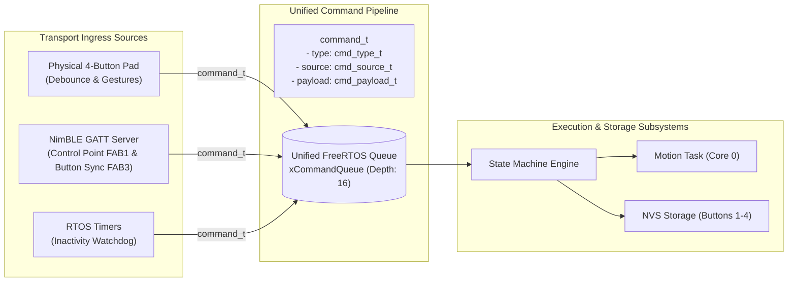

# Tech Stack — ESP32 Firmware

## Firmware Toolchain & Build System

| Layer | Tool / Standard | Details |
|---|---|---|
| **Framework / SDK** | Espressif ESP-IDF (v5.x / v6.x) | Native C / FreeRTOS development framework |
| **Language Standard** | C99 / C11 | High-efficiency embedded C with strict type definitions (`stdint.h`, `stdbool.h`) |
| **Target Microcontroller** | ESP32 Dev Board v1 / ESP-WROOM-32 | Dual-core Xtensa 32-bit LX6 @ 240 MHz, 520 KB SRAM, 4 MB SPI Flash |
| **Build System** | CMake 3.16+ & Ninja | Standard ESP-IDF build flow (`idf.py build`, `idf.py flash`, `idf.py monitor`) |
| **Reference Baseline** | `poc/esp_hello_world` | ESP-IDF structure, `esp_chip_info.h`, `esp_flash.h`, FreeRTOS tasks, `driver/gpio.h` |
| **Non-Volatile Storage** | ESP-IDF NVS Flash (`nvs_flash.h`) | Key-value blob sequence storage for 4 physical Button Routines (user-programmed & factory defaults) |
| **I2C Actuation Driver** | I2C Master (`driver/i2c.h` / `driver/i2c_master.h`) | Dedicated 100 kHz bus driving PCA9685 16-channel PWM servo controller (`0x40`) |
| **Wireless Stack** | Apache NimBLE (ESP-IDF Native) | Ultra-lightweight, dedicated BLE GATT server (`nimble/`) for mobile app integration |
| **OS / RTOS** | FreeRTOS (ESP-IDF SMP port) | Preemptive dual-core task scheduling, queues, event groups, and software timers |

---

## ESP32 Dual-Core Architecture & Task Allocation

```mermaid
graph LR
    subgraph Core 0 [Core 0: Motion & Hardware Bus Engine]
        direction TB
        M_TASK["app_main (Core 0)<br/>Command Consumer & Motion Engine"]
        I2C_MGR["PCA9685 PWM Driver (I2C NUM 0)"]
        ESTOP_ISR["E-Stop Abort Engine (<50ms)"]
        M_TASK --> I2C_MGR
        ESTOP_ISR -.->|Instant Preemption| M_TASK
    end

    subgraph Core 1 [Core 1: UI, BLE Wireless & System Coordination]
        direction TB
        BLE_TASK["app_ble_task (Priority 4)<br/>NimBLE GATT Server"]
        TELEM_TASK["app_telem_task (Priority 3)<br/>10Hz Progress & Motor Telemetry"]
        UI_TASK["app_ui_task (Priority 5)<br/>4-Button Debouncer (50ms)"]
        SM_CORE["State Machine Engine"]
        NVS_CORE["NVS Sequence Manager (Buttons 1-4)"]
        LED_TASK["app_led_task (Priority 2)<br/>Status LED Engine"]

        BLE_TASK -->|Dispatched command_t| CMD_Q
        UI_TASK -->|Dispatched command_t| CMD_Q
        CMD_Q --> SM_CORE
        SM_CORE --> LED_TASK
        SM_CORE --> NVS_CORE
        TELEM_TASK -.->|Notify Progress & Angles (FAB2)| BLE_TASK
        NVS_CORE -.->|Notify Config Changes (FAB3)| BLE_TASK
    end

    subgraph IPC [Inter-Core IPC]
        CMD_Q[("Unified Command Queue<br/>xCommandQueue (Depth: 16)")]
        STATE_GRP[("System Event Group<br/>xSystemEventGroup")]
    end

    SM_CORE -->|Trigger Motion| M_TASK
    UI_TASK -.->|E-Stop Flag| STATE_GRP
    BLE_TASK -.->|Wireless E-Stop / Stop| STATE_GRP
    STATE_GRP -.->|Abort Check| M_TASK
```

### Core 0 — Real-Time Motion & Actuation Engine
- **`app_main` Command Consumer & Motion Engine (Core ID: 0)**:
  - Consumes motion execution commands from the inter-core queue.
  - Implements smooth single-servo and synchronized parallel dual-servo sweep trajectories ($0^\circ \rightarrow 180^\circ \rightarrow 0^\circ$).
  - Controls deterministic dwell delays (300ms fold dwell, 200ms inter-step delay) using low-latency sliced delays.
  - Continuously samples the E-Stop / Stop abort event flag before and during step transitions ($<50\text{ms}$ preemption latency).
- **PCA9685 I2C Driver**: Direct register reads/writes over ESP32 hardware I2C peripheral (`I2C_NUM_0`).

### Core 1 — UI, Dedicated BLE Wireless, Telemetry & System Coordination
- **`app_ble_task` (Priority: 4, Core ID: 1)**:
  - Runs Apache NimBLE host stack and GATT server.
  - Ingests BLE commands via Control Point (`FAB1`): Start/Stop, Raw Sequence Preview, Button Sequence Save, Live Servo Jog, Identify, LED Mode, Factory Reset, E-Stop.
  - Publishes adaptive 10 Hz / 1 Hz real-time sequence progress and motor positions (`FAB2`).
  - Synchronizes 4 button sequence configurations (`FAB3`).
  - Proactively negotiates low-latency BLE GAP connection parameters (15.0ms–30.0ms), SMP link security, and 512-byte ATT MTU exchanges for both iOS and Android.
- **`app_telem_task` (Priority: 3, Core ID: 1)**:
  - Tracks sequence progress (active step, total steps, completion %) and live motor positions ($0^\circ \text{ to } 180^\circ$ for channels 0–15).
  - Packs binary `telemetry_packet_t` and pushes at 10 Hz during active motion/calibration (1 Hz in idle) to subscribed BLE centrals.
- **`app_ui_task` (Priority: 5, Core ID: 1)**:
  - Scans and debounces 4 physical push buttons with a 50ms software low-pass filter.
  - Differentiates between Short Tap (<500ms), Single-Button Long Press ($\ge 3000\text{ms}$ for BLE pairing window), and B1+B4 Simultaneous Hold ($\ge 5000\text{ms}$ for BLE bond reset).
  - Coordinates physical mode transitions and button gesture translations.
- **`app_led_task` (Priority: 3, Core ID: 1)**:
  - Non-blocking pattern generator driving 8 visual pulse trains on `GPIO 2` (including `LED_STATE_BLE_PAIRING`, `LED_STATE_BLE_CONNECTED`, and `LED_STATE_IDENTIFY`) with a strict preemption hierarchy preserving underlying base state.
- **`storage` Subsystem**:
  - Manages serialized read/write operations to ESP-IDF NVS flash for the 4 physical button routines, bonded BLE keys (`"ble_bonds"`), and factory default fallback with IEEE 802.3 CRC32 integrity validation.

---

## Hardware Pinout & Peripheral Configuration

### 1. ESP32 GPIO Pin Allocations

| Signal Name | ESP32 GPIO | Direction | Configuration | Active State | Description |
|---|---|---|---|---|---|
| `PIN_STATUS_LED` | `GPIO_NUM_2` | Output | Push-Pull / No Pull | High (1) | Visual status indicator LED (Built-in on DevKit) |
| `PIN_BTN_1` | `GPIO_NUM_4` | Input | Internal Pull-Up (`GPIO_PULLUP_ONLY`) | Low (0) | B1: Preset 1 Routine (Default: Adult T-Shirt) / E-Stop |
| `PIN_BTN_2` | `GPIO_NUM_16` | Input | Internal Pull-Up (`GPIO_PULLUP_ONLY`) | Low (0) | B2: Preset 2 Routine (Default: Long-Sleeve Shirt) / E-Stop |
| `PIN_BTN_3` | `GPIO_NUM_17` | Input | Internal Pull-Up (`GPIO_PULLUP_ONLY`) | Low (0) | B3: Preset 3 Routine (Default: Trousers / Jeans) / E-Stop |
| `PIN_BTN_4` | `GPIO_NUM_5` | Input | Internal Pull-Up (`GPIO_PULLUP_ONLY`) | Low (0) | B4: Preset 4 Routine (Default: Towel / Linen) / E-Stop |
| `PIN_I2C_SDA` | `GPIO_NUM_21` | I/O | Open-Drain + External 4.7k Pull-Up | — | PCA9685 I2C Data line (SDA) |
| `PIN_I2C_SCL` | `GPIO_NUM_22` | Output | Open-Drain + External 4.7k Pull-Up | — | PCA9685 I2C Clock line (SCL) |

### 2. PCA9685 PWM Driver Configuration

| Parameter | Value | Description |
|---|---|---|
| **I2C Port** | `I2C_NUM_0` | Hardware I2C controller |
| **I2C Address** | `0x40` | Default address (`A0–A5` grounded) |
| **I2C Clock Speed** | `100000` Hz (100 kHz) | Standard mode (supports 400 kHz fast mode) |
| **PWM Output Frequency** | `50` Hz | Standard 20ms period for analog/digital RC servos |
| **Prescale Value** | `121` (`0x79`) | $\text{Prescale} = \text{round}\left(\frac{25\text{ MHz}}{4096 \times 50\text{ Hz}}\right) - 1 = 121$ |
| **PWM Resolution** | 12-bit (4096 counts) | Range $0$ to $4095$ counts per 20ms frame |
| **Servo Min Pulse ($0^\circ$)** | $500\ \mu\text{s}$ ($\approx 102$ counts) | Flap resting flat on table ($0^\circ$ home) |
| **Servo Nudge Pulse ($15^\circ$)** | $667\ \mu\text{s}$ ($\approx 137$ counts) | Identification nudge angle |
| **Servo Staged Pulse ($30^\circ$)** | $833\ \mu\text{s}$ ($\approx 171$ counts) | Visual staging angle held on table |
| **Servo Fold Pulse ($180^\circ$)** | $2500\ \mu\text{s}$ ($\approx 512$ counts) | Full fold flip articulation |

---

## Core Software Libraries & ESP-IDF Drivers

1. **System & FreeRTOS**:
   - `esp_system.h`, `esp_chip_info.h`, `esp_flash.h`: System telemetry, heap monitoring, chip diagnostics.
   - `freertos/FreeRTOS.h`, `freertos/task.h`, `freertos/queue.h`, `freertos/event_groups.h`, `freertos/timers.h`.
2. **GPIO Driver**:
   - `driver/gpio.h`: Pin resets, direction configuration, pull-up resistors, and state reading.
3. **I2C Master Driver**:
   - `driver/i2c.h` / `driver/i2c_master.h`: Bus communication with PCA9685 (`0x40`) protected by FreeRTOS mutex.
4. **Bluetooth Low Energy (NimBLE)**:
   - `nimble/nimble_port.h`, `nimble/nimble_port_freertos.h`, `host/ble_hs.h`, `services/gap/ble_svc_gap.h`, `services/gatt/ble_svc_gatt.h`.
   - Lightweight, robust BLE stack requiring only $\approx 40\text{ KB}$ SRAM.
5. **NVS Flash Storage**:
   - `nvs_flash.h`, `nvs.h`: Partition initialization, key-value blob read/write operations for the 4 button routines with IEEE 802.3 CRC32 integrity validation.
6. **Logging & Debugging**:
   - `esp_log.h`: Structured logging (`MAIN`, `BLE`, `TELEM`, `BUTTONS`, `LED`, `PCA9685`, `MOTION`, `STORAGE`, `SM`).

---

## System Timing & Configuration Constants (`config.h`)

| Constant | Value | Description |
|---|---|---|
| `MAX_STEPS_PER_ROUTINE` | `16` | Maximum steps allowable per folding preset routine |
| `MAX_MOTORS_PER_STEP` | `2` | Maximum servos allowed to fold synchronously in 1 step |
| `TOTAL_SERVO_CHANNELS` | `16` | Total physical servo channels on the PCA9685 driver |
| `TOTAL_PRESET_COUNT` | `4` | Physical preset buttons on device (B1 to B4) |
| `COMMAND_QUEUE_LENGTH` | `16` | Unified command queue depth |
| `BUTTON_DEBOUNCE_MS` | `50` ms | Low-pass debounce sampling window |
| `BUTTON_LONG_PRESS_MS` | `3000` ms | Continuous hold duration threshold to enter 120s BLE pairing window |
| `BUTTON_BOND_RESET_MS` | `5000` ms | Simultaneous B1+B4 hold threshold to clear all BLE bonds in NVS |
| `BUTTON_SHORT_PRESS_MAX_MS` | `500` ms | Upper bound for tap gesture detection in Daily Run Mode |
| `BLE_PAIRING_TIMEOUT_MS` | `120000` ms | 120-second (2-minute) BLE pairing/discovery window timeout |
| `FOLD_DWELL_TIME_MS` | `300` ms | Dwell time holding flap at $180^\circ$ before returning |
| `INTER_STEP_DELAY_MS` | `200` ms | Settling delay between consecutive folding steps |
| `CALIBRATION_THERMAL_TIMEOUT_MS` | `10000` ms | Stationary servo thermal de-energize cutoff in calibration mode |
| `CALIBRATION_INACTIVITY_TIMEOUT_MS` | `15000` ms | Calibration inactivity watchdog auto-homing servos and exiting to Idle |
| `TELEMETRY_STREAM_ACTIVE_HZ` | `10` Hz | Active sequence execution & calibration streaming rate |
| `TELEMETRY_STREAM_IDLE_HZ` | `1` Hz | Idle low-power battery-saving streaming rate |
| `BLE_CONN_INTERVAL_MIN_MS` | `15.0f` ms | Minimum BLE connection interval (Apple Accessory compliant: 12 units) |
| `BLE_CONN_INTERVAL_MAX_MS` | `30.0f` ms | Maximum BLE connection interval (Apple Accessory compliant: 24 units) |
| `BLE_CONN_SLAVE_LATENCY` | `0` | Slave latency (no skipped connection events) |
| `BLE_SUPERVISION_TIMEOUT_MS` | `4000` ms | Supervision timeout (Apple compliant $\le 6000\text{ms}$) |
| `NUDGE_ANGLE_DEG` | `15.0f` | Motor identification sweep angle |
| `STAGE_ANGLE_DEG` | `30.0f` | Visual staging hold angle |
| `HOME_ANGLE_DEG` | `0.0f` | Flat panel rest position |
| `FOLD_ANGLE_DEG` | `180.0f` | Complete flap fold angle |

---

## Sequence & Telemetry Data Structures

### 1. Folding Sequence Structures (NVS Flash Storage)

```c
// Individual step containing 1 or 2 simultaneous servo motions (3 bytes packed, 0 padding)
typedef struct __attribute__((packed)) {
    uint8_t motor_count;                     // Number of active motors (1 or 2)
    uint8_t motor_ids[MAX_MOTORS_PER_STEP];  // Zero-indexed servo IDs (0 to 15)
} fold_step_t;

// Complete routine sequence structure stored in NVS flash blob for Buttons 1 to 4 (53 bytes packed)
// 1 byte step_count + (16 * 3 bytes steps) + 4 bytes CRC32 checksum = exactly 53 bytes
typedef struct __attribute__((packed)) {
    uint8_t step_count;                       // Number of steps in sequence (1 to 16)
    fold_step_t steps[MAX_STEPS_PER_ROUTINE]; // Array of sequence steps (48 bytes)
    uint32_t checksum;                        // IEEE 802.3 CRC32 checksum (4 bytes, Little-Endian)
} fold_routine_t;
```

### 2. High-Speed Sequence Progress & Motor Telemetry Packet (`telemetry_packet_t`)

Packed 31-byte binary frame broadcast over BLE Notify (`FAB2`) with adaptive streaming (10 Hz in active motion, 1 Hz when idle). Multi-byte integers are strictly **Little-Endian**:

```c
typedef struct __attribute__((packed)) {
    uint8_t system_state;            // system_state_t (0: Idle, 1: Running, 2: E-Stop, 3: Error, 4: Calibrating)
    uint8_t led_state;               // led_state_t (0: Idle, 1: Running, 2: Save Success, 3: Input Error, 4: E-Stop, 5: BLE Pairing, 6: BLE Connected, 7: Identify)
    uint8_t active_button_id;        // Active button (1-4 if executing button routine, 0 if preview/idle)
    uint8_t current_step_idx;        // Active step index (0-indexed, 0 to 15)
    uint8_t total_steps;             // Total steps in active routine (1 to 16)
    uint8_t step_progress_pct;       // Current step completion percentage (0-100%)
    uint16_t elapsed_step_time_ms;   // Elapsed time in active step (ms, Little-Endian)
    uint8_t channel_angles[16];      // Live angles for channels 0-15 (0 to 180 deg)
    uint8_t last_cmd_status;         // cmd_status_t (0: OK, 1: ERR_BUSY, 2: ERR_INVALID_STEP, 3: ERR_MOTOR_BOUNDS, 4: ERR_ROUTINE_FULL, 5: ERR_CRC_MISMATCH, 6: ERR_INVALID_ARG)
    uint16_t free_heap_kb;           // ESP32 internal free DRAM in KB (Little-Endian)
    int8_t ble_rssi_dbm;             // BLE RSSI in dBm (-128 if disconnected, signed int8)
    uint8_t error_code;              // Error bitmask (BIT0=I2C_Fail, BIT1=NVS_Fail, BIT2=EStop_Active)
    uint16_t sequence_counter;       // Monotonically increasing packet counter (Little-Endian)
} telemetry_packet_t;
```

### 3. Core Operational Enumerations & Status Codes

```c
typedef enum {
    STATE_IDLE_RUN = 0,     /* Ready for daily execution */
    STATE_RUNNING_MOTION,   /* Actively executing fold sequence */
    STATE_ESTOP,            /* E-stop triggered, servos homed */
    STATE_ERROR,            /* Hardware fault or I2C bus error */
    STATE_CALIBRATING       /* Servo jog / calibration mode */
} system_state_t;

typedef enum {
    LED_STATE_IDLE = 0,         /* Soft heartbeat pulse (0.5 Hz / 10% duty) */
    LED_STATE_RUNNING,          /* Solid ON during sequence execution */
    LED_STATE_SAVE_SUCCESS,     /* Solid ON for 2.0s */
    LED_STATE_INPUT_ERROR,      /* 3 fast flashes (60ms ON / 60ms OFF) */
    LED_STATE_ESTOP,            /* 5 rapid flashes (50ms ON / 50ms OFF) */
    LED_STATE_BLE_PAIRING,      /* Fast double-blink during 120s pairing window */
    LED_STATE_BLE_CONNECTED,    /* Solid ON for 1.0s, restores prior base state */
    LED_STATE_IDENTIFY          /* 3 fast double-blinks for 3.0s, restores prior base state */
} led_state_t;

typedef enum {
    CMD_STATUS_OK = 0,
    CMD_STATUS_ERR_BUSY          = 1, /* Motion busy or conflicting state (re-entrancy guard) */
    CMD_STATUS_ERR_INVALID_STEP  = 2, /* Step count out of bounds (1-16) or step index invalid */
    CMD_STATUS_ERR_MOTOR_BOUNDS  = 3, /* Motor count > 2 or motor channel ID > 15 */
    CMD_STATUS_ERR_ROUTINE_FULL  = 4, /* Exceeded maximum 16 steps */
    CMD_STATUS_ERR_CRC_MISMATCH  = 5, /* CRC32 integrity check failed */
    CMD_STATUS_ERR_INVALID_ARG   = 6  /* Invalid button ID (not 1-4) or out-of-range argument */
} cmd_status_t;
```

---

## Scalable Command Protocol & Unified Ingress

All system inputs (Physical Buttons, NimBLE GATT, Timers) converge into the single, thread-safe FreeRTOS `xCommandQueue`.



### 1. Command Definitions (`command.h`)

```c
typedef enum {
    SOURCE_PHYSICAL_BUTTON = 0, /* On-board physical 4-button pad */
    SOURCE_BLE             = 1, /* Bluetooth LE GATT connection */
    SOURCE_INTERNAL_TIMER  = 2  /* Internal RTOS timer / safety watchdog */
} cmd_source_t;

typedef enum {
    CMD_RUN_PRESET = 0,         /* Execute saved preset routine (1 to 4) */
    CMD_RUN_RAW_SEQUENCE,       /* Execute unsaved sequence payload directly */
    CMD_EMERGENCY_STOP,         /* Immediate E-Stop halt & home all servos */
    CMD_ENTER_BLE_PAIRING,      /* Open 120-second BLE discovery/pairing window (3s hold) */
    CMD_SET_BUTTON_SEQUENCE,    /* Save custom sequence to button slot (1 to 4) over BLE */
    CMD_RESTORE_FACTORY_PRESETS,/* Restore Buttons 1-4 to factory default routines */
    CMD_JOG_MOTOR_ANGLE,        /* Live position jog (0° to 180°) for calibration */
    CMD_GET_TELEMETRY,          /* Request real-time status telemetry */
    CMD_SYNC_PRESETS,           /* Synchronize presets over wireless transport */
    CMD_STOP_SEQUENCE,          /* Cleanly stop active motion / exit calibration / clear E-Stop */
    CMD_IDENTIFY_ROBOT,         /* Trigger 3.0s visual locator LED pulse train */
    CMD_SET_TELEMETRY_STREAM,   /* Enable or disable periodic BLE telemetry streaming */
    CMD_CLEAR_BLE_BONDS         /* Erase all stored BLE bonds in NVS (B1+B4 5s hold) */
} cmd_type_t;

typedef struct {
    uint8_t channel;            // PCA9685 channel index (0 to 15)
    float angle_deg;            // Target angular position (0.0 to 180.0 degrees; unpacked from uint8_t on BLE wire)
} jog_param_t;

typedef struct __attribute__((packed)) {
    uint8_t preset_id;          // Target button slot (1 to 4)
    fold_routine_t routine;     // Sequence data (53 bytes packed)
} button_sync_param_t;

typedef union {
    uint8_t preset_id;                  // For CMD_RUN_PRESET (1 to 4)
    fold_routine_t raw_routine;         // For CMD_RUN_RAW_SEQUENCE
    button_sync_param_t button_sync;    // For CMD_SET_BUTTON_SEQUENCE
    jog_param_t jog_param;              // For CMD_JOG_MOTOR_ANGLE (channel + angle_deg)
    bool stream_enable;                 // For CMD_SET_TELEMETRY_STREAM
} cmd_payload_t;

typedef struct {
    cmd_type_t type;
    cmd_source_t source;
    cmd_payload_t payload;
} command_t;
```

---

## Bluetooth Low Energy (NimBLE) GATT Specifications

### 1. Primary Service & Characteristics

* **Service UUID**: `0000FAB0-0000-1000-8000-00805F9B34FB` (Fabrica Robot Service)

| Characteristic | UUID | Properties | Descriptors | MTU / Size | Function |
|---|---|---|---|---|---|
| **Control Point (`FAB1`)** | `0000FAB1-...` | Write, Write Without Resp | `0x2901` (`"Fabrica Control Point (FAB1)"`) | $\le 55$ Bytes | Ingests binary commands: Start/Stop, Raw Preview, Button Sequence Save, Jog, Identify, Factory Reset, E-Stop. Supports both Write With Response and Write Without Response. |
| **Status & Telemetry (`FAB2`)** | `0000FAB2-...` | Notify, Read | `0x2902` (CCCD), `0x2901` (`"Fabrica Status & Telemetry (FAB2)"`) | $31$ Bytes | Streams adaptive telemetry (10 Hz motion/calibration, 1 Hz idle), LED state, live motor positions, and command status. |
| **Button Config Sync (`FAB3`)** | `0000FAB3-...` | Read, Write, Notify | `0x2902` (CCCD), `0x2901` (`"Fabrica Button Sequences 1-4 (FAB3)"`) | $212$ Bytes | Reads/writes 4 button sequences (`fold_routine_t`, packed) in full or compact format; auto-CRC; notifies on changes. |

#### 2. Control Point (`FAB1`) Binary Wire Framing Protocol

All commands sent over `FAB1` use a packed binary wire format (`[1B Opcode][Payload]`) with zero compiler struct padding and Little-Endian byte order, making them directly testable from off-the-shelf BLE scanner apps (**nRF Connect**, **LightBlue**) on both iOS and Android:

| Opcode (`uint8_t`) | Command Enumeration | Supported Write Types | Wire Payload Structure | Total Wire Size | Functional Description & Validation Rules |
|---|---|---|---|---|---|
| `0x00` | `CMD_RUN_PRESET` | Write / Write No Rsp | `[uint8_t preset_id (1-4)]` | 2 Bytes | Starts saved routine 1–4. Rejected if motion busy (`ERR_BUSY`) or empty sequence (`ERR_INVALID_STEP`). |
| `0x01` | `CMD_RUN_RAW_SEQUENCE` | Write / Write No Rsp | Full: `[53B fold_routine_t]`<br/>Compact: `[1B step_count][3B * N steps]` | 54 Bytes (Full)<br/>5–50 Bytes (Compact) | Previews unsaved sequence directly without modifying NVS. Reports `active_button_id == 0`. Compact format auto-zero-pads and computes CRC32. |
| `0x02` | `CMD_STOP_SEQUENCE` | Write Without Response / Write | *(None)* | 1 Byte | Cleanly stops active folding motion or calibration, homes all 16 flaps to $0^\circ$, and clears `STATE_ESTOP` back to `STATE_IDLE_RUN`. |
| `0x03` | `CMD_EMERGENCY_STOP` | Write Without Response / Write | *(None)* | 1 Byte | Instant $<50\text{ms}$ Core 1 fast-path preemption halting PWM output, homing all 16 servos to $0^\circ$, and latching `STATE_ESTOP`. |
| `0x0A` | `CMD_SET_BUTTON_SEQUENCE`| Write / Write No Rsp | Full: `[1B preset_id][53B fold_routine_t]`<br/>Compact: `[1B preset_id][1B step_count][3B * N steps]` | 55 Bytes (Full)<br/>6–51 Bytes (Compact) | Saves custom routine to Button 1–4 in NVS (wire alias for `FAB3` single-button write) and notifies `FAB3`. |
| `0x0B` | `CMD_GET_BUTTON_CONFIG` | Write / Write No Rsp | *(None)* | 1 Byte | Triggers single-shot 212-byte configuration notification push over `FAB3`. |
| `0x0C` | `CMD_RESTORE_FACTORY_PRESETS`| Write / Write No Rsp | *(None)* | 1 Byte | Restores Buttons 1–4 to factory default routines in NVS, homes servos, and dispatches notify on `FAB3`. |
| `0x0D` | `CMD_JOG_MOTOR_ANGLE` | Write Without Response / Write | `[1B channel (0-15)][1B angle_deg (0-180)]` | 3 Bytes | Live calibration jog. Transitions to `STATE_CALIBRATING`; rejected during active motion or E-Stop (`ERR_BUSY`). |
| `0x0E` | `CMD_IDENTIFY_ROBOT` | Write Without Response / Write | *(None)* | 1 Byte | Triggers 3.0s visual locator pulse train (`LED_STATE_IDENTIFY`) on status LED. |
| `0x10` | `CMD_GET_TELEMETRY` | Write / Write No Rsp | *(None)* | 1 Byte | Requests single-shot 31-byte telemetry frame push over `FAB2`. |
| `0x11` | `CMD_SET_TELEMETRY_STREAM`| Write / Write No Rsp | `[uint8_t enable (0 or 1)]` | 2 Bytes | Enables (`1`) or disables (`0`) periodic automatic telemetry streaming on `FAB2`. |

#### 3. Subsystem Protocol Rules & Safety Semantics:

* **Control Point (`FAB1`) & Dual-Mode Write Execution Flow**:
  - **Write Semantics**:
    - Both `Write Without Response` and `Write With Response` are accepted on `FAB1` so manual testing in **nRF Connect** or **LightBlue** works regardless of the selected write type.
    - `Write Without Response` is recommended for safety and real-time interactive commands (`CMD_EMERGENCY_STOP`, `CMD_STOP_SEQUENCE`, `CMD_JOG_MOTOR_ANGLE`) to eliminate GATT round-trip ACK latency and guarantee $<50\text{ms}$ preemption.
  - **Core 1 Fast-Path Preemption & Ingress Re-Entrancy Guard**:
    - When `CMD_EMERGENCY_STOP` (`0x03`) or `CMD_STOP_SEQUENCE` (`0x02`) arrives over BLE while motion is active, the Core 1 BLE ingress handler directly invokes `motion_emergency_stop()` (setting `MOTION_EVENT_ESTOP_BIT` on `xSystemEventGroup`) prior to queueing, achieving `<50ms` abort latency without waiting behind Core 0 trajectory loops.
    - If `CMD_RUN_PRESET`, `CMD_RUN_RAW_SEQUENCE`, `CMD_SET_BUTTON_SEQUENCE`, `CMD_RESTORE_FACTORY_PRESETS`, `CMD_JOG_MOTOR_ANGLE`, or a `FAB3` write is received while `motion_is_busy()` is true, the command is rejected immediately at ingress on Core 1 with `CMD_STATUS_ERR_BUSY` in telemetry without interrupting or queueing behind the active cycle.
  - **Empty Preset Validation**: If `CMD_RUN_PRESET` targets a preset with `step_count == 0`, firmware immediately rejects the execution with `CMD_STATUS_ERR_INVALID_STEP` and does not engage Core 0 motion tasks.
  - **Execution Completion Event**: When the final step finishes, the firmware emits a dedicated telemetry packet with `step_progress_pct = 100`, `current_step_idx = total_steps - 1`, and `last_cmd_status = CMD_STATUS_OK` before transitioning cleanly to `STATE_IDLE_RUN`.
  - **Stateless Raw Routine Validation & Preview**: Enforces $1 \le \text{step\_count} \le 16$, $1 \le \text{motor\_count} \le 2$, and valid channel indices ($0 \le \text{id} \le 15$); rejects invalid payloads with `CMD_STATUS_ERR_INVALID_STEP` or `CMD_STATUS_ERR_MOTOR_BOUNDS`. Telemetry reports `active_button_id == 0` during raw preview execution to distinguish from stored Buttons 1–4.
  - **E-Stop Clear & Recovery**: Sending `CMD_STOP_SEQUENCE` (`0x02`) over `FAB1` (or tapping any physical button) clears `STATE_ESTOP` back to `STATE_IDLE_RUN`.
  - **Command Status Feedback**: Command validation or execution results are immediately recorded in `last_cmd_status` and pushed via `FAB2`.

* **Live Calibration & Thermal Protection (`CMD_JOG_MOTOR_ANGLE`)**:
  - **State Transition**: Sending `CMD_JOG_MOTOR_ANGLE` (`0x0D`) from `STATE_IDLE_RUN` transitions `system_state` to `STATE_CALIBRATING`.
  - **Motion Safety Interlock**: Strictly rejects `CMD_JOG_MOTOR_ANGLE` if `system_state == STATE_RUNNING_MOTION` or `STATE_ESTOP` with `CMD_STATUS_ERR_BUSY` to prevent mechanical binding.
  - **Thermal Safety Cutoff (10s)**: Stationary servos in `STATE_CALIBRATING` automatically de-energize after 10 seconds of inactivity (`CALIBRATION_THERMAL_TIMEOUT_MS = 10000`) to protect servo motor windings from thermal stress.
  - **Auto-Home & Exit Lifecycle (15s)**: A 15-second inactivity watchdog (`CALIBRATION_INACTIVITY_TIMEOUT_MS = 15000`) or sending `CMD_STOP_SEQUENCE` (`0x02`) automatically homes all jogged channels back to $0^\circ$ and returns `system_state` to `STATE_IDLE_RUN`.

* **Button Configuration Sync (`FAB3`)**:
  - **Canonical Configuration Transport**: `FAB3` is the designated GATT interface for reading and writing button sequences.
  - **Active Motion Write Protection**: Any GATT Write to `FAB3` (or `CMD_SET_BUTTON_SEQUENCE`) while `motion_is_busy()` / `STATE_RUNNING_MOTION` is strictly rejected with `CMD_STATUS_ERR_BUSY`.
  - **GATT Read**: Returns the complete 212-byte table containing all 4 physical button routines ($4 \times 53\text{ bytes} = 212\text{ bytes}$, supporting both single-MTU read and offset-sliced `ATT_READ_BLOB_REQ` Long Reads).
  - **GATT Write (Full & Compact Formats)**: Accepts a 212-byte full 4-button table, a 54-byte single-button struct (`[1B preset_id (1-4)][53B fold_routine_t]`), OR a compact variable-length single-button payload (`[1B preset_id (1-4)][1B step_count (1-16)][3B * step_count steps]`, 5 to 50 bytes) for rapid manual entry in nRF Connect / LightBlue.
  - **CRC32 Boundary & Zero-Padding Rules**: The IEEE 802.3 CRC32 checksum is calculated over all 49 bytes preceding the `checksum` field (`offsetof(fold_routine_t, checksum)`). All unused step slots ($k \ge \text{step\_count}$) are zero-initialized (`0x00`).
  - **Auto-CRC Calculation**: If write payload uses compact format or provides `checksum == 0`, firmware auto-computes the valid IEEE 802.3 CRC32 before committing to NVS; if non-zero, validates and rejects with `CMD_STATUS_ERR_CRC_MISMATCH` if corrupted.
  - **GATT Notify**: Automatically dispatched to subscribed centrals whenever any button routine is modified in NVS or via `CMD_GET_BUTTON_CONFIG` (`0x0B`).

* **Adaptive Telemetry (`FAB2`), User Descriptors (`0x2901`) & CCCD (`0x2902`)**:
  - **Self-Describing Characteristics**: `FAB1`, `FAB2`, and `FAB3` expose standard read-only `0x2901` (Characteristic User Description) descriptors so off-the-shelf test apps (nRF Connect / LightBlue on iOS and Android) display human-readable names automatically.
  - **Adaptive Streaming Rate**:
    - Active Streaming ($10\text{ Hz}$): Active during `STATE_RUNNING_MOTION` and `STATE_CALIBRATING`.
    - Idle Streaming ($1\text{ Hz}$ + Event-Driven Push): Active during `STATE_IDLE_RUN`, `STATE_ESTOP`, and `STATE_ERROR` to conserve battery and prevent background notification throttling on iOS.
  - **Packet Structure**: Emits packed 31-byte `telemetry_packet_t` containing `system_state`, `led_state`, `active_button_id` (`0` for raw preview), `current_step_idx`, `total_steps`, `step_progress_pct`, `elapsed_step_time_ms`, 16 `channel_angles`, `last_cmd_status`, `free_heap_kb`, `ble_rssi_dbm`, `error_code`, and `sequence_counter` (all multi-byte fields Little-Endian).

#### 4. Firmware LED State & Telemetry Encoding (`led_state_t`)

| Value | Enumeration | Physical GPIO 2 Pattern | Pattern Type & Return Behavior |
|---|---|---|---|
| `0` | `LED_STATE_IDLE` | Soft heartbeat (`100ms` ON / `1900ms` OFF) | Persistent base state |
| `1` | `LED_STATE_RUNNING` | Continuous Solid ON | Persistent base state during active motion |
| `2` | `LED_STATE_SAVE_SUCCESS`| Solid ON for `2000ms` | Transient $\to$ returns to `LED_STATE_IDLE` |
| `3` | `LED_STATE_INPUT_ERROR` | 3 fast flashes (`60ms` ON / `60ms` OFF) | Transient $\to$ restores prior base state |
| `4` | `LED_STATE_ESTOP` | 5 rapid flashes (`50ms` ON / `50ms` OFF) | Transient $\to$ returns to `LED_STATE_IDLE` |
| `5` | `LED_STATE_BLE_PAIRING` | Fast double-blink (`100ms` ON / `100ms` OFF / `100ms` ON / `500ms` OFF) | Persistent base state during 120s pairing window |
| `6` | `LED_STATE_BLE_CONNECTED` | Solid ON for `1000ms` | Transient $\to$ restores prior base state |
| `7` | `LED_STATE_IDENTIFY` | 3 fast double-blinks (`3000ms` total) | Transient $\to$ restores prior base state |

---

### 2. Standard Device Information Service (DIS `0x180A`) & Generic Attribute Service (`0x1801`)

* **Generic Attribute Service (`0x1801`)**: Exposes Service Changed (`0x2A05`) indication so iOS and Android OS BLE stacks automatically refresh cached GATT handles across firmware updates.
* **Model Number String (`0x2A24`)**: `"Fabrica-DevKit-v1"`
* **Firmware Revision String (`0x2A26`)**: `"v1.13.0"`
* **Manufacturer Name String (`0x2A29`)**: `"Fabrica Robotics"`

### 3. Hold-to-Pair BLE Security, Native SMP Bonding & RPA Privacy Architecture

* **Single Active Central Policy**: `max_connections = 1`. The robot stops advertising while connected to a central and automatically restarts advertising upon disconnection.
* **Zero-Bond Out-of-the-Box Auto-Pairing (Indefinite Window)**:
  - When zero devices are bonded in NVS (such as on an unconfigured out-of-the-box unit or immediately following a hardware bond reset), Fabrica automatically enters **indefinite BLE Pairing Mode** (`LED_STATE_BLE_PAIRING` fast double-blink) on boot/reset without requiring any button press.
  - This pairing window **remains open indefinitely** until the first phone successfully connects, completes SMP bonding, and stores its bond in NVS.
  - When one or more devices are bonded, Fabrica boots directly into `STATE_IDLE_RUN` awaiting seamless auto-reconnection from trusted centrals or an explicit 3-second button hold to pair additional devices.
* **Hold-to-Pair Entry & Priority Preemption (3s Physical Button Hold)**:
  - Holding **any physical button (B1–B4) for 3 seconds** in `STATE_IDLE_RUN` (or `STATE_ESTOP` / `STATE_CALIBRATING`) dispatches `CMD_ENTER_BLE_PAIRING`.
  - When $\ge 1$ devices are already bonded, this opens a **120-second (2-minute) BLE Pairing Window** (`BLE_PAIRING_TIMEOUT_MS = 120000`), flashing `LED_STATE_BLE_PAIRING`, and immediately disconnecting any currently active BLE central (`ble_transport_enter_pairing_mode()`) so GAP advertising restarts with priority for the new mobile device.
  - Holding the button for 3 seconds on a brand new or wiped device also functions unconditionally (keeping pairing active).
  - **Native BLE SMP "Just Works" LE Secure Connections & Peripheral Security Initiation**:
    - Firmware enables NimBLE Security Manager (`sm_sc = 1`, `sm_bonding = 1`, `sm_mitm = 0`, `sm_io_cap = BLE_HS_IO_NO_INPUT_OUTPUT`, `BLE_SM_PAIR_KEY_DIST_ENC | BLE_SM_PAIR_KEY_DIST_ID`) and calls `ble_gap_security_initiate(conn_handle)` upon connection.
    - Initiating security from the peripheral side ensures both **iOS (`CoreBluetooth`)** (which never initiates pairing unless requested by the peripheral) and **Android (`BluetoothGatt`)** automatically trigger OS-level pairing and exchange **Identity Resolving Keys (IRKs)** when connected via off-the-shelf apps like **nRF Connect** or **LightBlue**.
  - **Unbonded Rejection Outside Pairing Window**: When bonds exist in NVS and the pairing window is not active, unbonded connection or pairing attempts are rejected and terminated (`ble_gap_terminate`), while already-bonded devices encrypt the link via stored LTK/IRK and remain connected.
  - **Resolvable Private Address (RPA) Resolution**: Both iOS and Android 10+ rotate BLE MAC addresses every ~15 minutes using RPAs. Storing peer IRKs in NVS via NimBLE's bond store (`ble_store_config_init()`, up to 4 devices) resolves rotating RPAs natively at the BLE link layer without requiring custom mobile app tokens.
  - **Bond Lifecycle & Eviction**: Supports up to 4 bonded devices in NVS. When a 5th device pairs during an active pairing window, the oldest bond is evicted automatically (FIFO/LRU).
  - **Hardware Bond Factory Reset (`B1 + B4` 5-Second Hold)**: Holding physical buttons B1 + B4 simultaneously for 5 seconds (`BUTTON_BOND_RESET_MS = 5000`) at power-on or in `STATE_IDLE_RUN` suppresses the 3s single-button pairing gesture, dispatches `CMD_CLEAR_BLE_BONDS`, clears all stored bonds in NVS, disconnects any active central, confirms with 3 fast LED flashes (`LED_STATE_INPUT_ERROR`), and immediately auto-starts indefinite BLE pairing mode (`LED_STATE_BLE_PAIRING`) now that zero bonds remain.
  - Upon successful pairing or bonded reconnect, the LED pulses `LED_STATE_BLE_CONNECTED` (1.0s solid ON, restoring prior base state).
  - **120-Second Pairing Timeout (Multi-Device Only)**: When $\ge 1$ devices are already bonded, if no new central bonds within 120 seconds after a 3s hold, `state_machine_tick()` closes the pairing window and restores `LED_STATE_IDLE`.

### 4. Advertising, Peripheral-Initiated Connection Parameters & MTU Negotiation

* **Advertising Packet Split (31-Byte Limit for iOS & Android)**:
  - **Primary Advertisement Packet (21 Bytes)**: Flags (`0x06`, 3B) + Complete List of 128-bit Service Class UUIDs (`0000FAB0-...`, 18B) $\le 31\text{B}$ legacy limit. Mandatory for iOS `CoreBluetooth` service-filtered and background scanning.
  - **Scan Response Packet (17 Bytes)**: Complete Local Name (`Fabrica-XXXX`, 14B derived from the last 2 bytes of the ESP32 BT MAC address) + Tx Power Level (3B) for immediate human-readable name display in nRF Connect and LightBlue on iOS and Android.
* **Advertising Interval**: 100ms fast advertising on startup or disconnect.
* **Peripheral-Initiated Connection Parameter Negotiation (`ble_gap_update_params`)**:
  - Firmware requests connection parameter updates from the peripheral side (1.5s after connection) compliant with Apple Bluetooth Accessory Design Guidelines and Android:
    - Connection Interval Min: `15.0ms` (12 units)
    - Connection Interval Max: `30.0ms` (24 units)
    - Slave Latency: `0`
    - Supervision Timeout: `4000ms` (400 units, satisfies $2000\text{ms} \le \text{Timeout} \le 6000\text{ms}$ and $> 3 \times \text{Interval Max} \times (\text{Latency}+1)$).
* **Peripheral- & Central-Initiated ATT MTU Exchange**:
  - Firmware sets preferred ATT MTU to 512 bytes (`ble_att_set_preferred_mtu(512)`), handles automatic central-initiated MTU exchange from iOS (`185–517` bytes), AND proactively calls `ble_gattc_exchange_mtu()` from the peripheral side so Android devices (default 23-byte MTU) automatically negotiate up to 512 bytes even in off-the-shelf test apps.
  - Implements offset-sliced GATT Long Read (`ATT_READ_BLOB_REQ`) on `FAB2` and `FAB3` as a fallback for legacy 23-byte MTU centrals.

---

## FreeRTOS Task Budget & Memory Allocation

### 1. Task Partitioning & CPU Core Affinity

| Task Name | Core | Priority | Stack Size | Description |
|---|---|---|---|---|
| `app_main` | Core 0 | 1 | System Default | Command queue consumer, motion trajectories, I2C commands, $<50\text{ms}$ E-Stop |
| `app_ui_task` | Core 1 | 5 | 3072 Bytes | 4-button scanning, debouncing, gesture recognition (Tap, 3s Hold, 5s B1+B4 Reset), state timer |
| `app_ble_task` | Core 1 | 4 | 4096 Bytes | Apache NimBLE host stack, GATT server, SMP security, MTU & connection param negotiation |
| `app_telem_task` | Core 1 | 3 | 2048 Bytes | Progress tracking, live motor position packing, and adaptive 10 Hz / 1 Hz notify |
| `app_led_task` | Core 1 | 3 | 2048 Bytes | Status LED non-blocking pattern pulse train generator |

### 2. Internal SRAM & Heap Budget Analysis

* **Total Internal SRAM**: $520\text{ KB}$ ($\approx 320\text{ KB}$ available for application heap).
* **Firmware Baseline (Phases 1–7)**: Consumes $\approx 85\text{ KB}$.
* **Apache NimBLE Stack**: Consumes $\approx 40\text{ KB}$.
* **Telemetry & Sequence Buffers**: Consumes $\approx 4\text{ KB}$.
* **Net Available Application Free Heap**: $\ge 190\text{ KB}$ (substantial headroom, rock-solid long-term stability).

---

## File & Directory Structure

```
firmware/
├── specs/                          ← Project specifications (mission.md, tech-stack.md, roadmap.md)
├── CMakeLists.txt                  ← Root ESP-IDF project CMake file
├── Makefile                        ← Host test runner & helper entrypoint
├── sdkconfig.defaults              ← Default SDK configuration (240MHz, 1000Hz tick, 4MB flash, NimBLE enabled)
├── main/                           ← Main firmware component
│   ├── CMakeLists.txt              ← Component source & requirement registration
│   ├── main.c                      ← System initialization, chip diagnostics, task bootstrap
│   ├── config.h                    ← Single source of truth for pinouts, timings, limits, thresholds
│   ├── command.h                   ← Unified source-agnostic command protocol & packed structures
│   ├── buttons.h / buttons.c       ← 4-button debouncing & gesture recognition (Tap, 3s Hold, 5s B1+B4 Reset)
│   ├── led.h / led.c               ← Non-blocking multi-pattern LED controller engine
│   ├── pca9685.h / pca9685.c       ← I2C Master driver for PCA9685 16-channel PWM generator
│   ├── motion.h / motion.c         ← Real-time motion execution task, trajectory delays, E-Stop
│   ├── storage.h / storage.c       ← ESP-IDF NVS flash manager for 4 button sequences
│   ├── state_machine.h / .c        ← System state machine coordinating Run, E-Stop & Calibration
│   ├── ble_transport.h / .c        ← Apache NimBLE GATT server, SMP security, MTU & Conn Param manager
│   ├── remote_cmd.h / remote_cmd.c ← BLE wire protocol parser, compact sequence unpacker & fast-path guards
│   └── telemetry.h / telemetry.c   ← Adaptive 10 Hz / 1 Hz progress & motor angle serialization
├── test/                           ← Host-based unit tests and mock BLE/hardware harness
└── README.md                       ← Build, flash, monitor instructions, hardware setup & BLE test app guide
```
