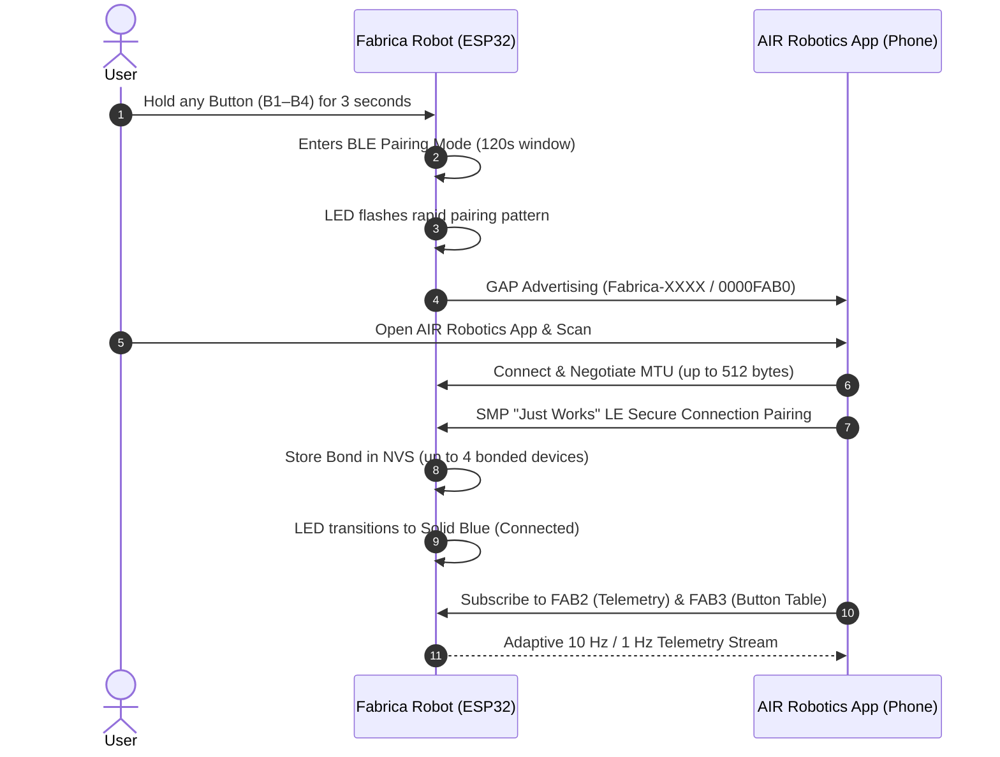

# Fabrica Mobile Application — AIR Robotics App

> **Notice**: The source code for the Fabrica companion mobile application is maintained in a dedicated external repository:  
> **Repository**: [https://github.com/aiandrobotics/air-robotics-app](https://github.com/aiandrobotics/air-robotics-app)

This directory serves as the integration reference, wire protocol specification, and BLE communication documentation for connecting the **AIR Robotics App** (or any Bluetooth Low Energy client) to the **Fabrica Cloth Folding Robot** embedded firmware.

---

## Overview

The **AIR Robotics App** is a cross-platform mobile application (iOS & Android) designed to wirelessly monitor, configure, calibrate, and operate the Fabrica Cloth Folding Robot over Bluetooth Low Energy (BLE).

While the Fabrica robot is fully functional out of the box using its physical 4-button interface, the mobile app provides an interactive graphical interface for advanced customization, real-time folding animation previews, motor position tracking, and garment profile sharing.

---

## Core Capabilities & Architecture

- **Dedicated Remote Repository**: The full mobile application codebase, UI components, state management, and build configurations are hosted at [https://github.com/aiandrobotics/air-robotics-app](https://github.com/aiandrobotics/air-robotics-app).
- **Hold-to-Pair Security**: Connects securely during a 120-second pairing window initiated by holding any physical button on the robot for 3 seconds (`LED_STATE_BLE_PAIRING`). Supports up to 4 bonded devices in NVS with Resolvable Private Address (RPA) privacy resolution for iOS and Android.
- **Client-Side Garment Profiles**: Manage, build, and share custom garment folding profiles client-side in the app (e.g., T-Shirts, Long Sleeves, Jeans, Towels, Hoodies) with full multi-motor support (up to 16 channels, including Left, Right, Bottom, and Top/Collar flaps).
- **Stateless Routine Preview (`CMD_RUN_RAW_SEQUENCE` / `0x01`)**: Test custom folding sequences directly on the robot from your phone without overwriting physical button slots.
- **Wireless Button Assignment (`CMD_SET_BUTTON_SEQUENCE` / `FAB3`)**: 1-touch persistence of custom profiles to physical Buttons 1–4 with automatic IEEE 802.3 CRC32 checksum generation and flash verification.
- **Real-Time Telemetry & LED Mirroring (`FAB2`)**: Live 10 Hz motor position tracking ($0^\circ \text{ to } 180^\circ$ across all channels) and 1:1 visual LED status mirroring with battery-saving 1 Hz idle throttling.
- **Execution & Safety Control (`FAB1`)**: Wirelessly trigger presets, preview raw sequences, jog motors for calibration, and trigger $<50\text{ms}$ Emergency Stop aborts with automatic panel homing.
- **Interactive Servo Jog Calibration (`CMD_JOG_SERVO` / `0x0D`)**: Fine-tune resting, staged, and fold angles with 10-second thermal cutoffs and 15-second inactivity auto-homing.
- **1-Tap Factory Reset (`CMD_RESTORE_FACTORY_PRESETS` / `0x0C`)**: Instantly restore the 4 built-in factory default routines exercising all 4 motors.

---

## Bluetooth Low Energy (BLE) Interface Specification

The robot firmware exposes an Apache NimBLE GATT server conforming to Apple Accessory Design Guidelines and Android BluetoothGatt specifications:

### Device Identification & Advertising

- **Device Name**: `Fabrica-XXXX` (where `XXXX` is derived from the last 2 bytes of the ESP32 MAC address).
- **Advertising Payload**: Split 31-byte advertising packets — 128-bit Primary Service UUID in initial advertisement (for iOS background discovery) and device name in scan response.
- **Device Information Service (DIS)** (`0x180A`):
  - Model Number (`0x2A24`): `Fabrica-DevKit-v1`
  - Firmware Revision (`0x2A26`): `v1.13.0`
  - Manufacturer Name (`0x2A29`): `AIR Robotics`

### Custom Fabrica Service (`FAB0`)

- **Primary Service UUID**: `0000FAB0-0000-1000-8000-00805F9B34FB`

| Characteristic | UUID | Properties | Payload Size | Purpose |
|---|---|---|---|---|
| **Control Point (`FAB1`)** | `0000FAB1-0000-1000-8000-00805F9B34FB` | Write, Write Without Response | 1 to 54 Bytes | Remote execution, stop, E-Stop, jog, identify, telemetry rate |
| **Telemetry (`FAB2`)** | `0000FAB2-0000-1000-8000-00805F9B34FB` | Read, Notify | 31 Bytes (Packed) | Live motor angles (Ch 0–15), step progress %, elapsed time, LED state, error codes |
| **Button Table (`FAB3`)** | `0000FAB3-0000-1000-8000-00805F9B34FB` | Read, Write, Notify | 212 Bytes (4 × 53B) | Read, configure, and synchronize routine sequences for Buttons 1–4 |

### Common Wire Opcodes on `FAB1`

| Opcode | Hex | Name | Payload Structure | Description |
|---|---|---|---|---|
| `0` | `0x00` | `CMD_RUN_PRESET` | `[0x00][preset_id 1..4]` | Trigger execution of saved preset 1, 2, 3, or 4 |
| `1` | `0x01` | `CMD_RUN_RAW_SEQUENCE` | `[0x01][53B routine / compact steps]` | Preview temporary routine on robot without saving to flash |
| `2` | `0x02` | `CMD_STOP_SEQUENCE` | `[0x02]` | Stop currently active folding sequence |
| `3` | `0x03` | `CMD_EMERGENCY_STOP` | `[0x03]` | Fast-path hardware abort (<50ms) and latch E-Stop |
| `10` | `0x0A` | `CMD_SET_BUTTON_SEQUENCE` | `[0x0A][preset_id][routine / steps]` | Program and persist custom sequence to Button 1, 2, 3, or 4 |
| `11` | `0x0B` | `CMD_GET_BUTTON_CONFIG` | `[0x0B]` | Query current button configuration table |
| `12` | `0x0C` | `CMD_RESTORE_FACTORY_PRESETS` | `[0x0C]` | Reset physical buttons 1–4 to factory default folding routines |
| `13` | `0x0D` | `CMD_JOG_MOTOR_ANGLE` | `[0x0D][channel 0..15][angle 0..180]` | Live angle jog for servo alignment and calibration |
| `14` | `0x0E` | `CMD_IDENTIFY_ROBOT` | `[0x0E]` | Pulse status LED train for physical robot identification |
| `16` | `0x10` | `CMD_GET_TELEMETRY` | `[0x10]` | Trigger one-shot 31-byte telemetry read |
| `17` | `0x11` | `CMD_SET_TELEMETRY_STREAM` | `[0x11][enable 0\|1]` | Mute or resume automated telemetry notifications |

---

## Pairing & Connection Flow

---

## Testing Without the Custom Mobile App

The Fabrica BLE GATT service can also be tested using generic, off-the-shelf App Store BLE scanner applications on iOS and Android:

- **nRF Connect for Mobile** (Nordic Semiconductor) — Available on [Google Play](https://play.google.com/store/apps/details?id=no.nordicsemi.android.mcp) and [Apple App Store](https://apps.apple.com/app/nrf-connect-for-mobile/id1054362403).
- **LightBlue** (Punch Through) — Available on iOS and Android.

For step-by-step generic scanner playbooks and ready-to-paste hexadecimal payloads, refer to the [Firmware BLE Playbook](../firmware/README.md#app-store-ble-test-app-playbook).

---

## Links & References

- **Mobile App Source Code**: [https://github.com/aiandrobotics/air-robotics-app](https://github.com/aiandrobotics/air-robotics-app)
- **Firmware Source Code & BLE GATT Implementation**: [firmware/](../firmware/)
- **Mechanical CAD Designs**: [cad-designs/](../cad-designs/)
- **Project Documentation**: [docs/](../docs/)
